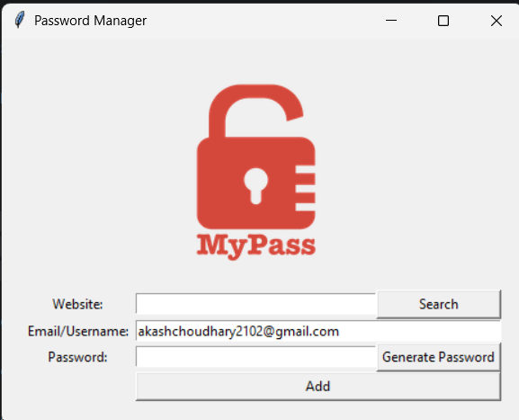
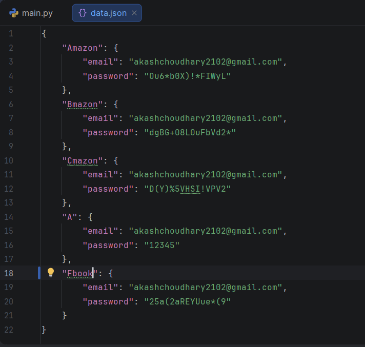

# 🔐 Password Manager

A simple desktop **Password Manager** built with **Python** and **Tkinter**. This application allows you to generate secure passwords, save login credentials locally in a JSON file, and quickly search for saved passwords.

## ✨ Features

* 🔑 Generate strong random passwords
* 📋 Automatically copy generated passwords to the clipboard
* 💾 Save website credentials (website, email/username, password)
* 🔍 Search for saved passwords by website
* 📂 Store credentials locally in a `data.json` file
* 🖥️ Clean and user-friendly GUI built with Tkinter

---

## 📸 Screenshot

> Screenshot of window where user interact with password manager



> Screenshot of saved password file.



---

## 🛠️ Technologies Used

* Python 3
* Tkinter
* JSON
* Random
* Pyperclip

---

## 📦 Installation

1. Clone the repository:

```bash
git clone https://github.com/your-username/password-manager.git
```

2. Navigate to the project folder:

```bash
cd password-manager
```

3. Install the required dependency:

```bash
pip install pyperclip
```

4. Run the application:

```bash
python main.py
```

---

## 🚀 How to Use

### 1. Save a Password

* Enter the website name.
* Enter your email or username.
* Click **Generate Password** (or type your own).
* Click **Add**.
* Confirm the details when prompted.

The credentials will be saved in `data.json`.

---

### 2. Search for a Password

* Enter the website name.
* Click **Search**.
* If credentials exist, the saved email and password will be displayed.
* The password is automatically copied to your clipboard.

---

### 3. Generate a Secure Password

Click **Generate Password** to create a strong random password containing:

* Uppercase letters
* Lowercase letters
* Numbers
* Special characters

The generated password is automatically copied to your clipboard.

---

## 📁 Data Storage

All credentials are stored locally in a file named:

```text
data.json
```

Example:

```json
{
    "github.com": {
        "email": "example@gmail.com",
        "password": "aB8#K2!LmP"
    },
    "google.com": {
        "email": "example@gmail.com",
        "password": "X7$pL9@Q"
    }
}
```

---

## 📋 Requirements

* Python 3.8 or later
* pyperclip

Install dependencies:

```bash
pip install pyperclip
```

---

## 📂 Project Structure

```text
password-manager/
│
├── main.py          # Main application
├── data.json        # Saved credentials
├── logo.png         # Application logo
└── README.md
```

---

## ⚠️ Notes

* Passwords are stored locally in plain JSON format.
* This project is intended for learning purposes and is **not recommended for storing sensitive credentials** without adding encryption and stronger security measures.
* If `data.json` does not exist, it will be created automatically when you save your first password.

---

## 🔮 Future Improvements

* Encrypt stored passwords
* Master password authentication
* Password strength indicator
* Dark mode
* Edit and delete saved credentials
* Export and import password database
* Search suggestions
* Cross-platform packaging (Windows, macOS, Linux)

---

## 🤝 Contributing

Contributions are welcome!

1. Fork the repository.
2. Create a feature branch.
3. Commit your changes.
4. Push the branch.
5. Open a Pull Request.

---

## 📄 License

This project is open source and available under the MIT License.

---

## 👨‍💻 Author

**Akash Anand**

If you found this project helpful, consider giving it a ⭐ on GitHub!
